# Preponderous Software Website

## Description

The Preponderous Software website is a [Next.js](https://nextjs.org/) web application that serves as the public face of Preponderous Software. It showcases the projects — free, source-available games, simulations, libraries, tools, and websites — and links out to their source on GitHub. Built with React and [Material UI](https://mui.com/), it mirrors the structure of the [Dan's Plugins Community website](https://github.com/Dans-Plugins/dansplugins-dot-com).

<p align="center">
  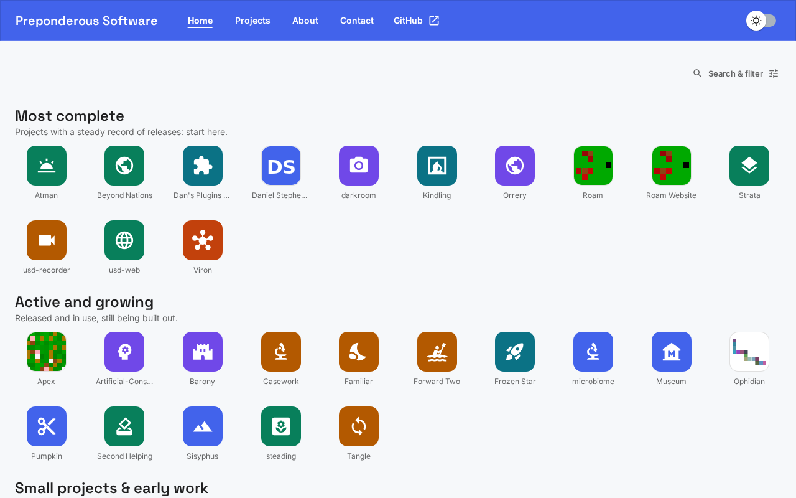
  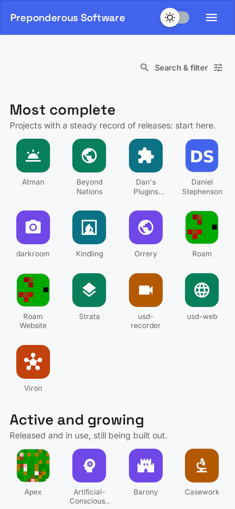
</p>
<p align="center"><em>The home page at desktop and phone width. More in <a href="#a-tour-of-the-site">A tour of the site</a> below.</em></p>

## A tour of the site

Every picture here is a real page from a production build of this repository (`npm run build` then `next start`), captured with headless Chromium. Desktop shots are 1280×800 at 1× pixel density. Phone shots are 390×844 at 2×. Light and dark mode follow the visitor's system setting until they pick one with the toggle.

### Home: every project as an icon

<table>
  <tr>
    <td width="50%"></td>
    <td width="50%">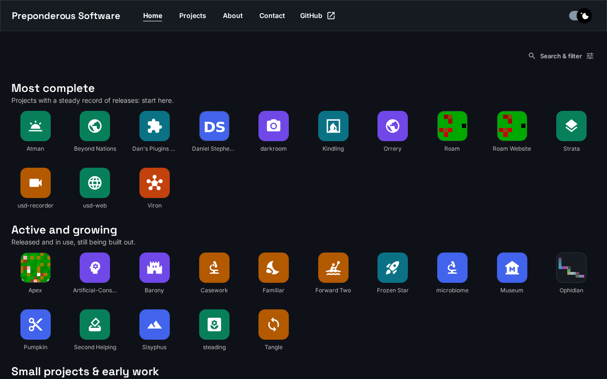</td>
  </tr>
  <tr>
    <td colspan="2"><em>Projects are grouped by how far along they are, most complete first. Search &amp; filter, top right, folds out a search box and category, technology and status chips.</em></td>
  </tr>
</table>

<p align="center">
  
  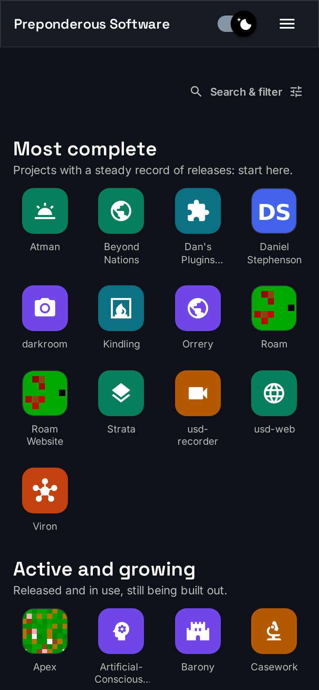
</p>
<p align="center"><em>On a phone, the top bar's links fold into a menu and the grid drops to four icons per row.</em></p>

### A project's details, with its 3D preview

<table>
  <tr>
    <td width="50%">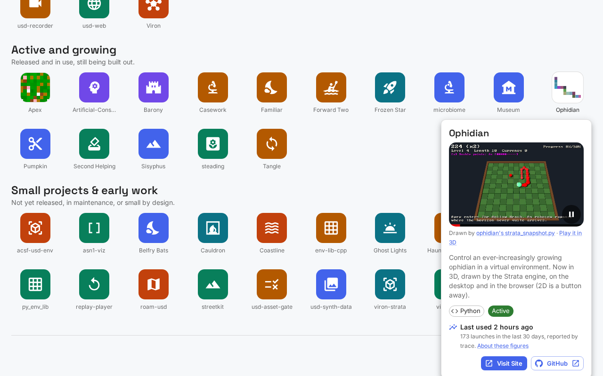</td>
    <td width="50%">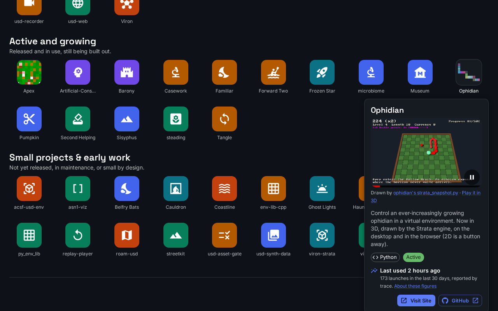</td>
  </tr>
  <tr>
    <td colspan="2"><em>Pointing at an icon, or moving to it with the keyboard, opens its details. Projects with a <code>preview</code> show a muted, looping 3D clip with a pause button, or only the still for visitors who ask for reduced motion. (The usage line in these panels uses the sample figures described under /usage below.)</em></td>
  </tr>
</table>

<p align="center">
  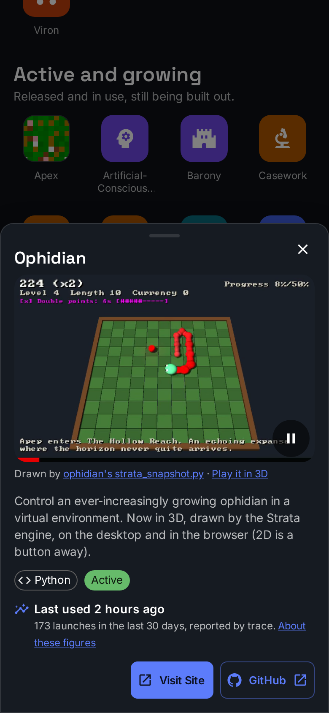
</p>
<p align="center"><em>On a touch screen, a tap opens the same details in a bottom sheet.</em></p>

### /projects: the same projects as cards, by category

<table>
  <tr>
    <td width="40%">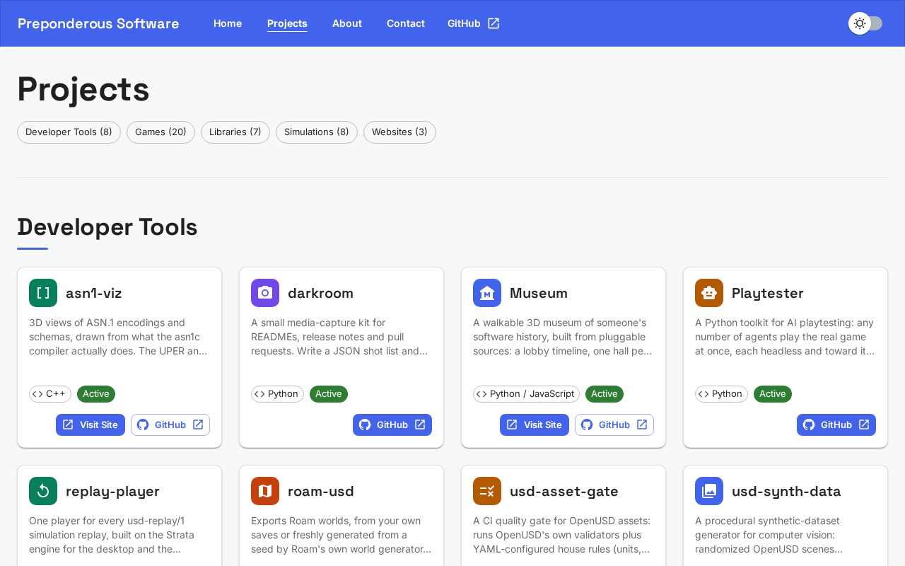</td>
    <td width="40%">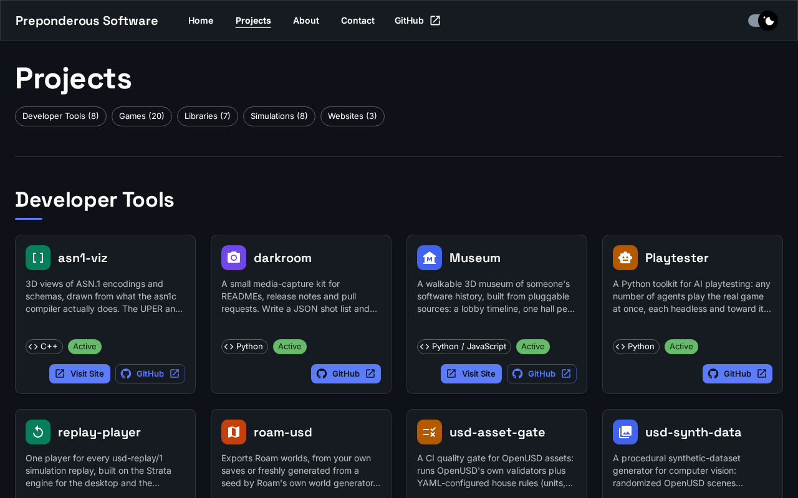</td>
    <td width="20%">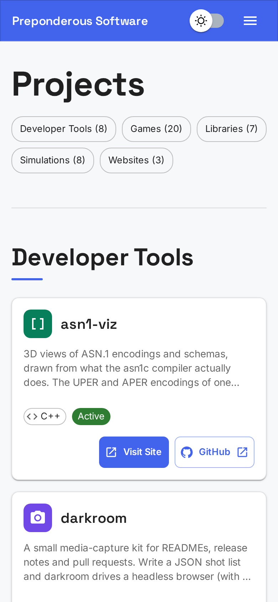</td>
  </tr>
  <tr>
    <td colspan="3"><em>Each category is its own section, and the links under the title jump straight to one. A card has a GitHub button, plus Visit Site where the project is hosted; a site whose source is private (Daniel Stephenson) has Visit Site only.</em></td>
  </tr>
</table>

### /usage: how much the projects are used

<table>
  <tr>
    <td width="40%">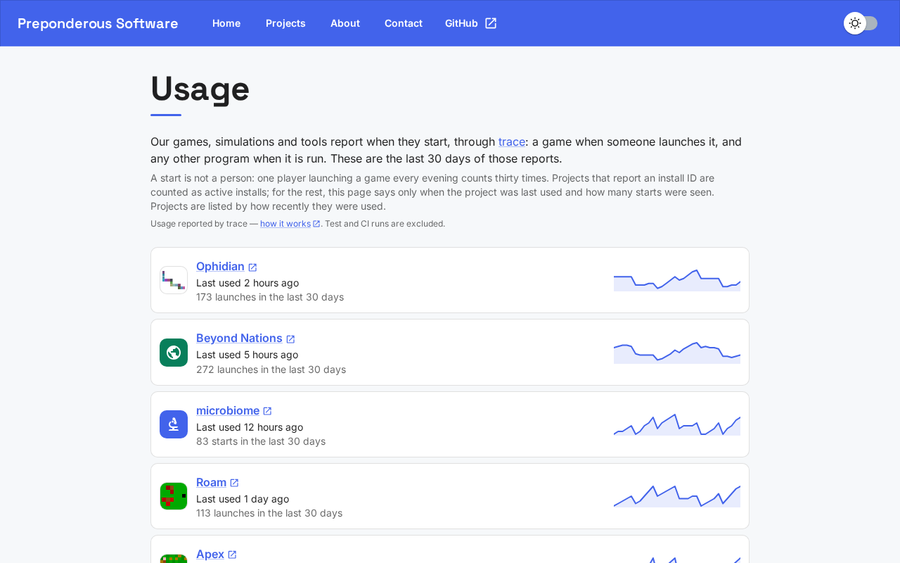</td>
    <td width="40%">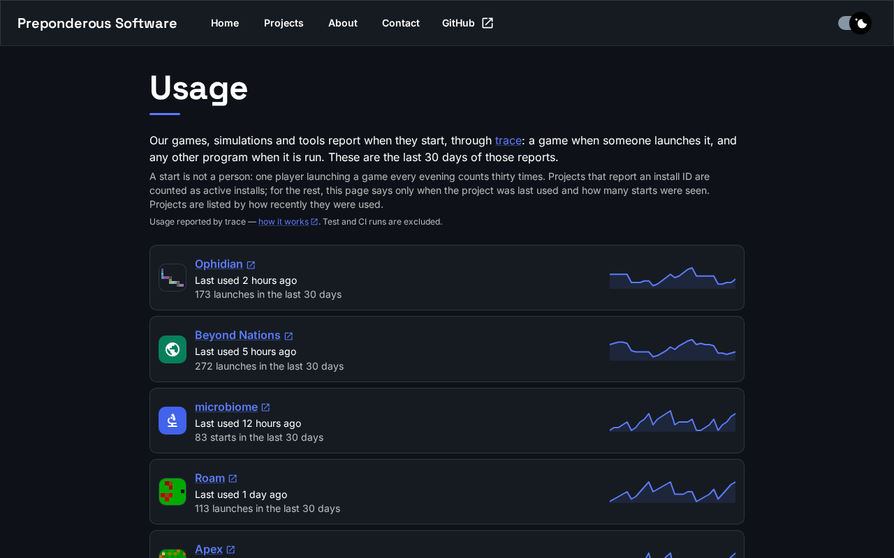</td>
    <td width="20%">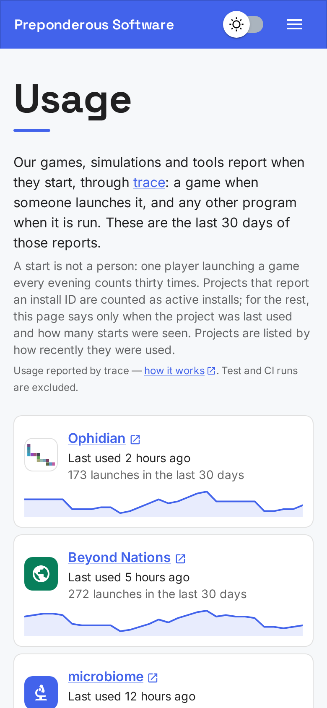</td>
  </tr>
  <tr>
    <td colspan="3"><em>Starts per project over 30 days, read server side from <a href="https://trace.danielstephenson.dev">trace</a>. <strong>These shots use made-up sample figures</strong> from a local stub (<code>TRACE_PUBLIC_URL</code>, see <a href="CONFIG.md">CONFIG.md</a>), so the numbers are not real usage. When trace can't be reached, the page says the figures are unavailable.</em></td>
  </tr>
</table>

### /about and the 404 page

<table>
  <tr>
    <td width="50%">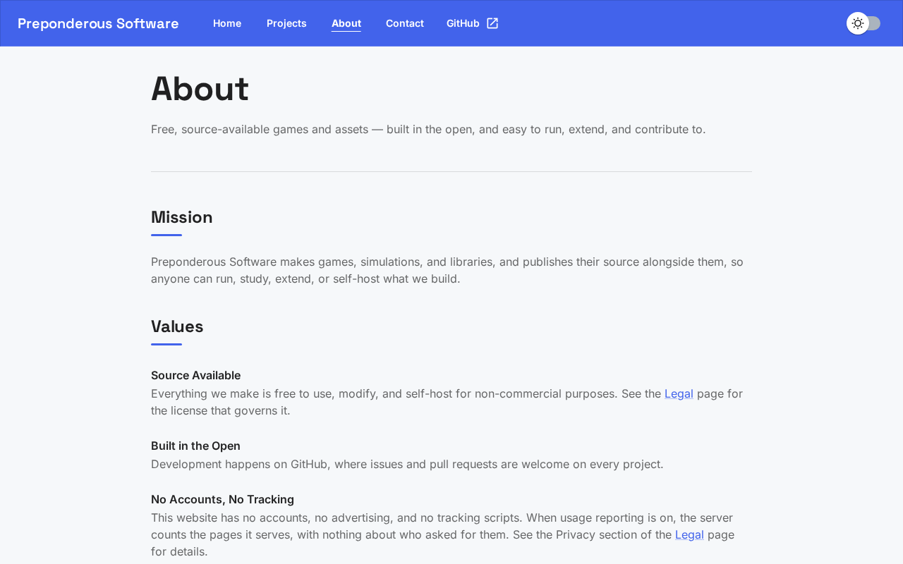</td>
    <td width="50%">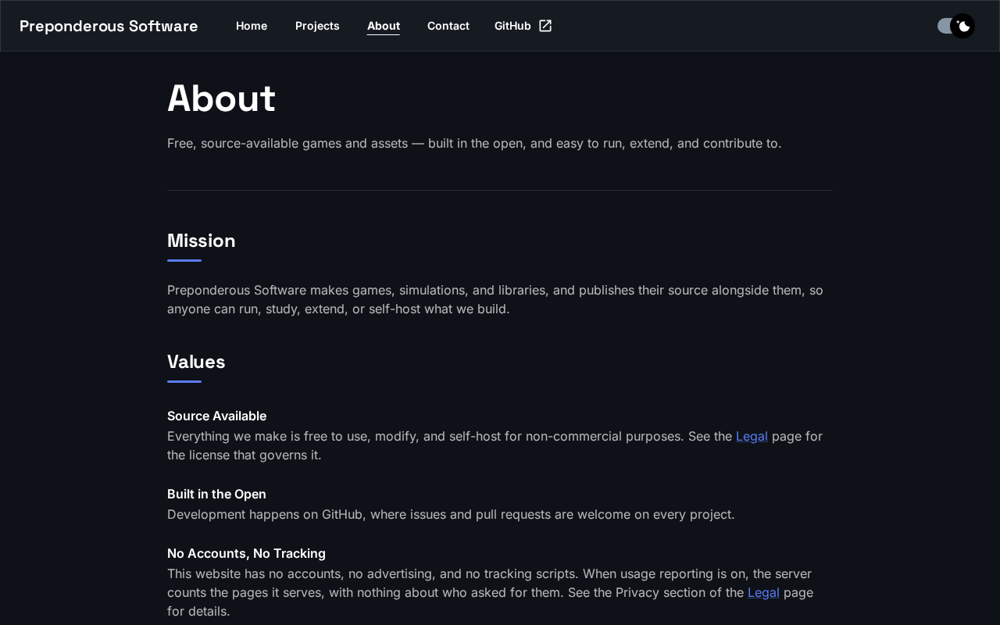</td>
  </tr>
  <tr>
    <td width="50%">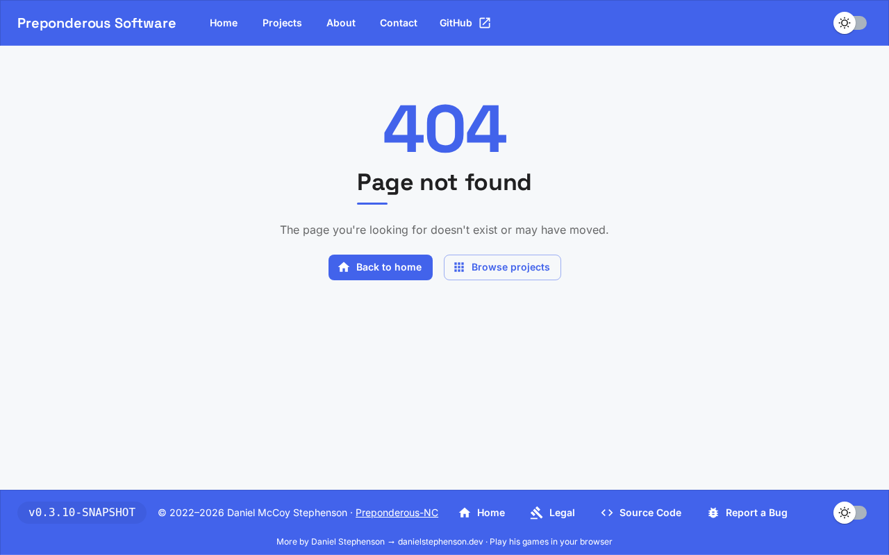</td>
    <td width="50%">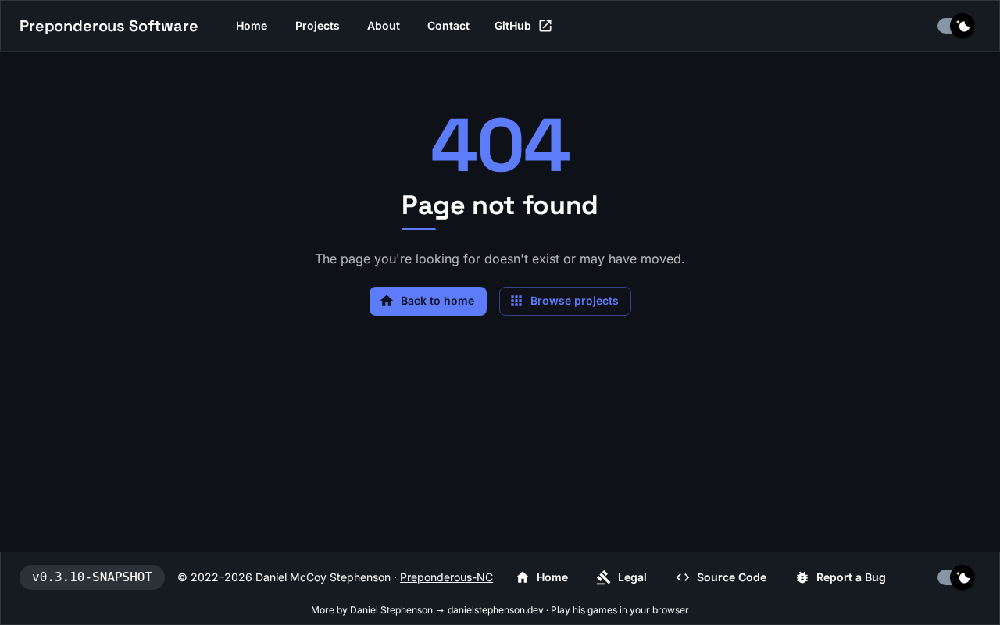</td>
  </tr>
  <tr>
    <td colspan="2"><em>/about covers the mission, values and who runs Preponderous Software. A broken link lands on the shared error page, which is kept out of search results.</em></td>
  </tr>
</table>

<sub>How these were captured: headless Chromium (Playwright) against <code>next start</code> on a local production build of <code>main</code> on 2026-11-25, after the self-hosted fonts and darker tile colours landed. The usage figures in the /usage and details shots come from a local trace stub, as noted above, because trace's public endpoints were not answering at capture time.</sub>

## Installation

### First Time Installation

1. Ensure [Node.js](https://nodejs.org/en/) (v18.17 or later, the minimum Next.js 14 supports) is installed on your machine.
2. Clone this repository: `git clone https://github.com/Preponderous-Software/preponderous-dot-org.git`
3. Install dependencies:
   ```bash
   npm install
   ```
4. Build the project:
   ```bash
   npm run build
   ```
5. Start the server:
   ```bash
   npm run start
   ```

The site will be available at `http://localhost:3000`.

### Other Ways to Run It

`npm run dev` is the day-to-day development server, Docker Compose runs the production build in a container, and a dev container provides a ready-made Node toolchain. See the [Development](#development) section below for all three.

## Usage

### Documentation

- [User Guide](USER_GUIDE.md) – Getting started and common scenarios
- [Configuration Guide](CONFIG.md) – Configuration and the project showcase data
- [Contributing](CONTRIBUTING.md) – How to contribute
- [Changelog](CHANGELOG.md) – Release history

## Support

### Experiencing a bug?

Please file a bug report [here](https://github.com/Preponderous-Software/preponderous-dot-org/issues/new).

- [Known Bugs](https://github.com/Preponderous-Software/preponderous-dot-org/issues?q=is%3Aissue+is%3Aopen+label%3Abug)

## Usage reporting

When the server is given a trace key in `USAGE_REPORTING_KEY`, it reports one `page-view` event per
HTML page it serves to [trace](https://trace.danielstephenson.dev), as the program `preponderous-dot-org`,
carrying the page's path (for example `/about` — never a query string or fragment) and the site
version. Nothing about the visitor is sent: no IP address, user agent, cookie, session, account or
referrer. No script is added to any page — the report is made by the server (Next.js middleware),
so the key never reaches the browser — and crawlers, uptime monitors, prefetches, API calls,
assets and 404s are not counted.

Every page view also carries a random **installation ID** for the server (the tag `install`), so
trace can count installations of the site rather than raw events. It is a UUID made when the
server first reports, derived from nothing about the server or any visitor. `TRACE_INSTALL_ID`,
when set, is used as is; otherwise the client is pointed at
`$XDG_DATA_HOME/preponderous-dot-org/trace-install-id` (or `~/.local/share/preponderous-dot-org/trace-install-id`).
The report is made from Next.js middleware, which runs in the Edge runtime and has no file system,
so in practice the ID lives in memory for the life of the server process: each restart or redeploy
counts as a new installation unless `TRACE_INSTALL_ID` is set. To reset it, restart the server or
change `TRACE_INSTALL_ID` (or delete the file, where a runtime with file access created one). Every
switch below also stops it: with reporting off no ID is made, read or written.

Reporting is off unless a key is set, and any of these turns it off:

- `USAGE_REPORTING_ENABLED=false` in the server's environment (set to any value but `true`, `on`,
  `yes` or `1` turns it off, so empty, `off`, `disabled` or a typo does too)
- `TRACE_USAGE_REPORTING=off` in the environment (any value but empty, `true`, `on`, `yes` or `1`;
  shared by every program that reports to trace, and it wins over the setting above)
- `DO_NOT_TRACK=1` in the environment (any value but empty, `0`, `false`, `off` or `no`; see
  [consoledonottrack.com](https://consoledonottrack.com))
- leaving `USAGE_REPORTING_KEY` unset

`USAGE_REPORTING_ENDPOINT` sends the reports to a different trace server. The server logs one line
on its first page request saying whether reporting is on and, if a switch turned it off, which kind:
`environment` for `TRACE_USAGE_REPORTING` or `DO_NOT_TRACK`, or `USAGE_REPORTING_ENABLED`. It logs
nothing when the key is simply unset. Details: https://danielstephenson.dev/usage-reporting

The other direction — how much the projects themselves are used — is read from trace's public
figures and shown on `/usage` and in each reporting project's details on the home grid. Those
figures are starts (a game launched, a program run), never presented as people or installs;
"active installs" is shown only once trace counts distinct installs. See [CONFIG.md](CONFIG.md)
(`TRACE_PUBLIC_URL`).

## Contributing

See [CONTRIBUTING.md](CONTRIBUTING.md).

## Testing

### Lint

```bash
npm run lint
```

If you see no errors, the lint check has passed.

### Unit Tests

The site uses [Vitest](https://vitest.dev/) for unit tests. Run the suite with:

```bash
npm test
```

Test files live in the `__tests__/` directory. If all tests pass, the suite has succeeded.

## Development

### Hot-Reloading Dev Server

`npm run dev` is the hot-reloading path — edits are picked up without a restart:

```bash
npm run dev
```

The site has no separate back end: the only server-side parts — the `/usage` page, `GET /api/usage`, `GET /version.json`, and the page-view middleware — run inside the same Next.js server, so this is the whole stack; there is nothing else to start. It requires no environment variables (see [CONFIG.md](CONFIG.md)); without them, nothing is reported and the usage figures are read from the public trace server.

### Docker Compose

`compose.yaml` builds the site from the `Dockerfile` and serves the **production build** on port 3000, so it does *not* hot-reload: source is copied into the image at build time, and changes need a rebuild.

1. Install [Docker Desktop](https://www.docker.com/products/docker-desktop) (or another Docker engine with the Compose plugin).
2. Build and start the container:
   ```bash
   docker compose up --build
   ```
   The site will be available at `http://localhost:3000`. The container restarts automatically unless stopped.
3. Stop it with:
   ```bash
   docker compose down
   ```

The image is built from `package-lock.json` with `npm ci`. The install step sees the manifests with their `version` set to a fixed value, so a version bump alone does not invalidate the cached dependency layer; the real `package.json` is copied in before `npm run build`. `.dockerignore` keeps `node_modules`, `.next`, the tests, and the Markdown docs out of the build context.

### Dev Container

`.devcontainer/` describes a [dev container](https://containers.dev/) with Node.js 18 pre-installed, for editors that support them (e.g. VS Code with the Dev Containers extension, or GitHub Codespaces). Open the repository in the container, then run `npm install` and `npm run dev` inside it as usual — dependencies are not installed automatically. Port 3000 is forwarded to the host.

## Technologies Used

- [Next.js](https://nextjs.org/) 14 (React 18)
- [Material UI](https://mui.com/) with [Emotion](https://emotion.sh/)
- [community-site-kit](https://github.com/kingdom-community/community-site-kit) for the home page's project grid and its search and filters, shared with dansplugins.com and danielstephenson.dev (installed from GitHub at a pinned commit; see `package.json`)
- [TypeScript](https://www.typescriptlang.org/)
- [Vitest](https://vitest.dev/) for unit testing

## 📄 License

This project is licensed under the **Preponderous Non-Commercial License (Preponderous-NC)**.
It is free to use, modify, and self-host for **non-commercial** purposes, but **commercial use requires a separate license**.

> **Disclaimer:** *Preponderous Software is not a legal entity.*
> All rights to works published under this license are reserved by the copyright holder, **Daniel McCoy Stephenson**.

Full license text:
[https://github.com/Preponderous-Software/preponderous-nc-license/blob/main/LICENSE.md](https://github.com/Preponderous-Software/preponderous-nc-license/blob/main/LICENSE.md)

## Project Status

This project is in active development. It has been redesigned from its original Spring Boot + Thymeleaf implementation to the Next.js stack described above.
